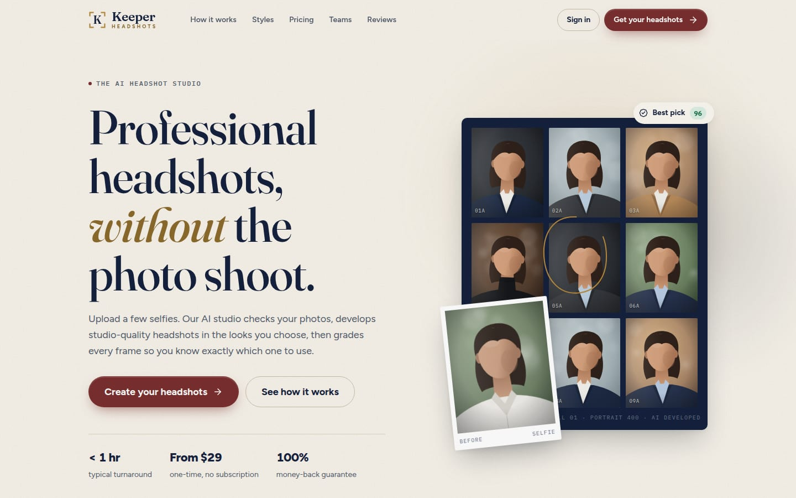
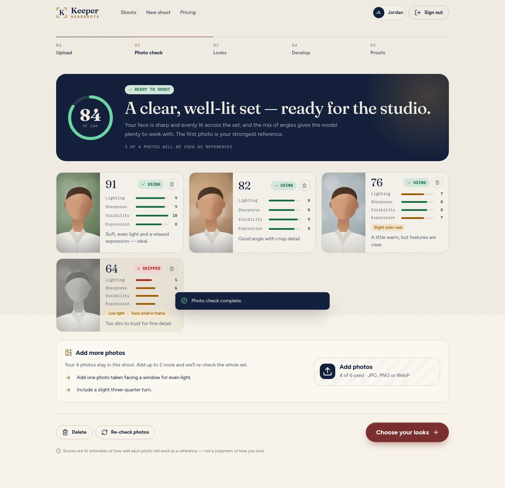
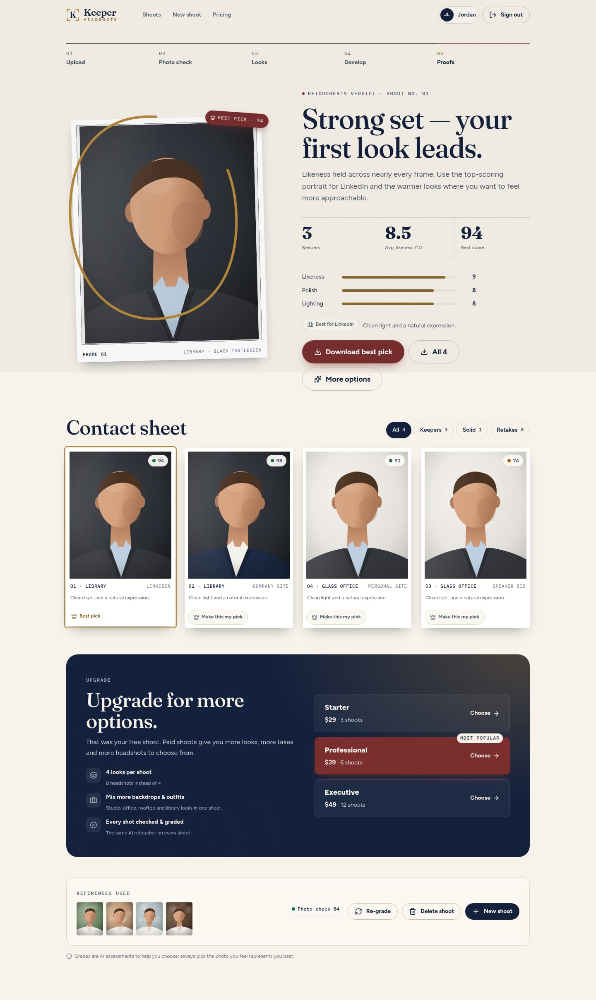

# Keeper Headshots

Upload a few selfies and get professional AI headshots back — checked, developed and graded by AI. Live at [keeperheadshots.com](https://keeperheadshots.com). The whole product is designed like a photographer's **contact sheet**; the tagline is *"Headshots worth keeping."*



## The core feature is real

A shoot runs through three AI steps. None of them use hardcoded answers.

| Step | Model | What it does |
| --- | --- | --- |
| **Photo check** | Claude (`claude-opus-5`, vision + structured output) | Scores each selfie for lighting, sharpness, face visibility and expression, flags issues (sunglasses, filters, blur), decides which photos to keep as references, and returns an overall verdict: *ready*, *usable* or *retake*. |
| **Develop** | Gemini image model (`gemini-3-pro-image`) | Renders each look (backdrop × outfit × pose take) from your kept reference photos, with a prompt built to preserve identity. Frames stream into the UI as they finish. |
| **Retoucher review** | Claude | Compares every headshot with your originals, grades likeness, polish (AI artifacts) and lighting, labels each one *keeper*, *solid* or *retake*, suggests where to use it (LinkedIn, speaker bio…) and circles one **best pick**. |

Claude calls use the server-side refusal fallback (`fallbacks: "default"`), and the app handles refusals, rate limits, bad keys, partial failures (retry just the failed frames), server restarts mid-shoot (the shoot can be resumed) and a review that fails after rendering (retry grading only).

| Photo check | Graded proofs |
| --- | --- |
|  |  |

## Run it

```bash
cd keeperheadshots
npm install
cp .env.example .env      # add ANTHROPIC_API_KEY and GEMINI_API_KEY
npm start                 # http://localhost:3000
```

- **Demo account:** `demo@keeperheadshots.com` / `studio-demo`. It's seeded with two finished sample shoots so every screen has content. Sample images are illustrations and are labelled "Sample".
- Without API keys the app still runs. The studio shows an "AI studio is temporarily unavailable" banner, and the API returns `503 ai_not_configured` instead of pretending.
- Locally, data (users, shoots, images) lives in `./data` as JSON and files. Delete the folder to reset; the demo reseeds the next time someone signs in as the demo user.

### Deploying to Vercel

The same code runs on Vercel as an Express function:

- **Storage:** with a private Vercel Blob store connected (`BLOB_READ_WRITE_TOKEN`), all users, shoots and images live in Blob. Without it, the app uses `./data` on disk.
- **Rendering:** no long-lived background job. Each progress poll calls `advance()`, which claims pending frames up to `GENERATION_CONCURRENCY` and renders each one in the background of that request (`waitUntil`, up to 300 s). Frames that stall past the lease are marked failed and can be retried.
- **Uploads:** photos go up one per request, so each body stays under Vercel's 4.5 MB limit.
- **Environment variables:** `ANTHROPIC_API_KEY`, `GEMINI_API_KEY`, `SESSION_SECRET` (required on Vercel), `BLOB_READ_WRITE_TOKEN` (added when the Blob store is connected), and optionally `STRIPE_SECRET_KEY`, `STRIPE_WEBHOOK_SECRET` and `OWNER_EMAILS`.

### Free trial and limits

Enforced on the server (`lib/plan.js`):

- **Free trial:** one free shoot per account, up to 2 looks (4 headshots).
- **After the trial:** developing needs a credit (`user.credits`); each paid shoot uses one. Stripe purchases add credits.
- **Free-account cap:** 6 completed photo checks in total.
- **Everyone except owners:** up to 2 re-grades per shoot.
- **Demo account:** read-only (browse the sample shoots only).
- **Owners:** emails listed in `OWNER_EMAILS` (comma-separated) have no limits.

### Payments (Stripe)

With `STRIPE_SECRET_KEY` set, the pricing buttons open Stripe Checkout (`lib/billing.js`). Packages live in `public/js/shared/catalog.js`:

| Package | Price | Shoots |
|---|---|---|
| Starter | $29 | 3 |
| Professional | $39 | 6 |
| Executive | $49 | 12 |

A paid shoot allows 4 looks (8 headshots). Purchases add credits to the account, and each developed shoot uses one. Payments are confirmed in up to three ways, recorded once per Checkout Session so a purchase is never credited twice:

- when the buyer returns to the dashboard after paying;
- on later dashboard visits, which catches a closed tab;
- optionally, a Stripe webhook: point it at `/api/billing/webhook` for `checkout.session.completed`, and set `STRIPE_WEBHOOK_SECRET`.

### Flow

`/` landing → `/signup` or `/signin` → `/app` (your shoots) → `/app/new` (upload) → `/app/shoot/:id`, which moves through **Photo check → Looks → Develop → Proofs** based on the shoot's server-side status.

## Design direction: "Studio Heritage"

The brand is about replacing a photo studio, so the UI borrows a studio's own artifacts: contact sheets with frame numbers, prints with captions, and the grease-pencil loop a photographer draws around the keeper frame.

- **Palette:** Ink Navy `#14213D` is the dominant tone, on Ivory `#F7F3EA`. Brass `#B8893B` (and deep brass `#8C6A2C` for text) marks the viewfinder, highlights and the "best pick" loop. Oxblood `#7A2E2E` is kept for featured moments: badges, the popular package and offers. Stone `#6B665B` is the neutral. Semantic success, warning and danger colors cover grades.
- **Type:** *Fraunces* for display (editorial, with italics for emphasis), *Figtree* for UI and body, *IBM Plex Mono* for frame numbers, labels and data, with tabular numbers.
- **System:** everything is driven by CSS tokens in `public/css/app.css`: a fluid type scale, a 4px spacing scale, radius, shadow and motion tokens (`--ease-out`, `--ease-spring`, and no linear easing except spinners). There is a film-grain overlay, and gradient-mesh lighting on dark surfaces.
- **Motion:** a staggered hero reveal with the grease-pencil circle drawing itself in, scroll reveals, a scanning skeleton during the photo check, and frames "developing" out of a sepia blur. `prefers-reduced-motion` turns all of it off.
- **States:** skeleton loaders, empty dashboard, form validation, API errors, AI-not-configured, partial render failures, grading failure, 404, and disabled, hover, focus and pressed states on every control.

- **Logo:** a Fraunces serif "K" framed by brass viewfinder corners, beside "Keeper" in Fraunces semibold over "HEADSHOTS" in tracked Figtree caps. Tagline: "Headshots worth keeping."

## Before launch

- The testimonials on the landing page and sign-in screen are placeholder copy. Replace them with real customer quotes.
- The landing page promises a 100% money-back guarantee. Make sure there's a refund policy and a way to honour it.
- `hello@keeperheadshots.com` is live (ImprovMX forwarding; Gmail "Send mail as").

## Project layout

```
server.js                 Express app: auth, shoots API, media, static SPA
lib/ai.js                 Claude photo check + review, Gemini rendering, prompts
lib/pipeline.js           Shoot orchestration, concurrency, retries, recovery
lib/storage.js            disk or Vercel Blob backend
lib/store.js, lib/auth.js data model, scrypt passwords, signed-cookie sessions
public/js/views/*         landing, auth, dashboard, studio (the shoot flow)
public/js/shared/*        style catalog + sample portrait illustrations (browser + server)
scripts/seed.js           demo account and sample shoots
scripts/dev/*             QA only: local API test double, API e2e, screenshot runner
```

### QA without spending API credits

`scripts/dev/mock-ai.js` is a local stand-in for the Anthropic and Gemini HTTP APIs. The app uses it only if you explicitly point the base URLs at it, so the real SDK code paths, parsing, polling and every UI state can be exercised offline:

```bash
npm run mock-ai &
ANTHROPIC_API_KEY=test GEMINI_API_KEY=test \
ANTHROPIC_BASE_URL=http://localhost:4010 GEMINI_BASE_URL=http://localhost:4010 PORT=3100 npm start &
node scripts/dev/api-e2e.js
node scripts/dev/screenshots.js shots   # phone (390px) + desktop (1440px) click-through
```
